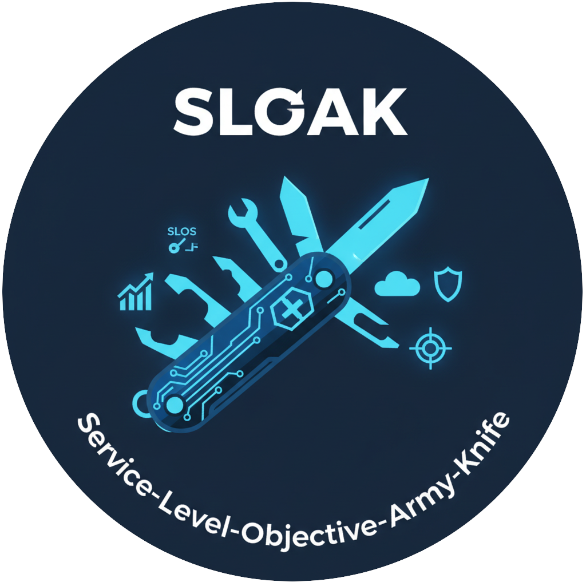
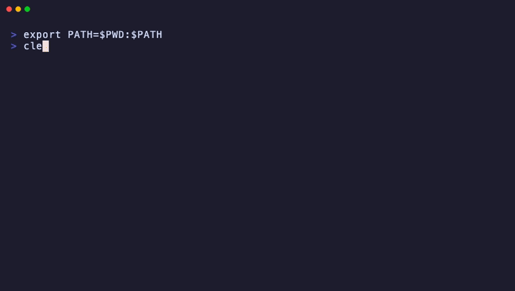

<div align="center">



# SLOAK: Service-Level-Objective Army Knife

**The Swiss Army Knife for SREs, Platform Engineers, and Reliability Practitioners.**

[](./go.mod)
[](./LICENSE)
[](./.go-arch-lint.yml)
[](https://openslo.com/)

[Features](#-features) • [Installation](#-installation) • [Quickstart](#-quickstart--workflows) • [Templates](#-supported-observability-templates) • [Configuration](#-configuration) • [Command Reference](#-command-reference)

</div>

---

`sloak` is a command-line tool designed to take the friction out of **Service Level Objective (SLO) engineering**. Based on the principles from the [Google SRE Workbook](https://sre.google/workbook/implementing-slos/), it simplifies error budget calculations, multi-window burn rate tracking, architecture feasibility assessments, and renders production alerting configurations across popular observability platforms using CUE templates and OpenSLO specifications.

<div align="center">
  
</div>

---

## ⚡ Features

- ⏱️ **Core SRE Math**: Calculate exact allowed downtime budgets over any arbitrary sliding window (`30d`, `90d`, `1y`).
- 🔥 **Multi-Window Burn Rate Triage**: Forecast time-to-exhaustion and determine whether ongoing incidents breach your budget.
- 🩺 **Feasibility & Operational Reality**: Check if a target SLO (e.g. 99.99%) is mathematically possible given your team's average MTTR and incident frequency.
- 🚀 **Disruption Budgets**: Compute maximum deployment or restart allowances based on downtime cost per event.
- 🔗 **Composite Availability**: Model serial (weakest link) and parallel (redundant) multi-service dependencies.
- 🔄 **Nines Converter**: Instant bidirectional translation between availability percentages (e.g. `99.95%`) and allowed downtime per day/month/quarter/year.
- 🚨 **Multi-Window Multi-Burn-Rate (MWMBR) Alerts**: Generate standard Google SRE alerting tables for paging, notifications, and tickets.
- 🎨 **Polyglot Observability Rendering**: Generate alerting rules for Prometheus Operator, Grafana Cloud (Mimir/Loki), OpenTelemetry Collector, Datadog SLOs, and Incident.io Alert Sources using built-in or custom CUE templates.
- 📄 **OpenSLO Specification Ingestion**: Directly parse OpenSLO YAML specifications (`--spec`) to render production alert rules.
- 🤖 **CI/CD & Automation Ready**: All calculation commands support `-o json` for GitOps pipelines and automated policy gates.

---

## 🛠 Installation

### Using `go install` (Recommended)
```bash
go install github.com/MichielVanderhoydonck/sloak/cmd/sloak@latest
```

### Building from Source
```bash
# Clone repository
git clone https://github.com/MichielVanderhoydonck/sloak.git
cd sloak

# Build binary
go build -o sloak cmd/sloak/main.go

# Verify installation
./sloak --help
```

---

## 🚀 Quickstart & Workflows

### 1. Calculate Error Budgets
Determine allowed failure time for a target SLO over a defined window:

```bash
sloak calculate errorbudget --slo 99.9 --window 30d
```

```text
--- Error Budget Calculation ---
SLO Target: 99.900%
Time Window: 30.0d
--------------------------------
Error Budget: 0.1000% of time
Allowed Downtime: 43m12s
```

> [!TIP]
> Add `-o json` to feed calculated error budget metrics into custom automation scripts or CI/CD dashboards.

---

### 2. Triage an Active Incident (Burn Rate Analysis)
Assess how fast an active degradation is consuming your budget and predict when it will be exhausted:

```bash
sloak calculate burnrate --slo 99.9 --window 30d --elapsed 7d --consumed 30m
```

```text
--- Burn Rate Analysis ---
SLO Target: 99.900%
Time Window: 30.0d
Total Error Budget: 43m12s
--------------------------
Budget Consumed: 69.44% (Time Elapsed: 23.33%)
Burn Rate: 2.98x
Budget Remaining: 13m12s

Status: WARNING (Ticket). Budget is burning faster than sustainable.
Forecast: Budget will be empty in 3.1d
Predicted Exhaustion: Sun, 25 Oct 2026 23:45:12 CEST
```

---

### 3. Check SLO Feasibility vs MTTR
Prevent setting unachievable SLOs by calculating required MTBF (Mean Time Between Failures) against your team's real MTTR:

```bash
sloak calculate feasibility --slo 99.9 --mttr 30m
```

```text
--- SLO Feasibility Analysis ---
Target SLO:   99.900%
Average MTTR: 30m0s

--- Operational Reality ---
To maintain 99.900% with a 30m0s response time:

Max Incident Frequency:
  • Per Year:    17.5 incidents
  • Per Quarter: 4.4 incidents
  • Per Month:   1.5 incidents

Required Reliability (MTBF):
  • Systems must run for 20.8d without failure.

Status: REALISTIC
Allows multiple incidents per quarter.
```

---

### 4. Generate SRE MWMBR Alert Tables
Generate the standard Google SRE alerting matrix with short/long windows and burn-rate multipliers:

```bash
sloak generate alert-table --slo 99.9 --window 30d
```

```text
--- SRE Alerting Table ---
SLO: 99.900% | Window: 30.0d

THRESHOLD   SHORT WINDOW   LONG WINDOW   BURN RATE   NOTIFICATION   
---------   ------------   -----------   ---------   ------------   
2%          5m0s           1h0m0s        14.40x      Page           
5%          30m0s          6h0m0s        6.00x       Message        
10%         6h0m0s         3.0d          1.00x       Ticket         
```

---

### 5. Render Production Observability Configs
Render turnkey alert definitions using built-in CUE templates, values overrides, or OpenSLO specifications:

```bash
# Render Prometheus Operator PrometheusRule resource (with recording rules)
sloak render \
  --template prometheus-operator \
  --slo 99.9 \
  --set metric_name=checkout_requests \
  --set errors_query='http_requests_total{job="checkout",code=~"5.."}' \
  --set total_query='http_requests_total{job="checkout"}' \
  --set namespace=monitoring > prometheus-rules.yaml

# Render Datadog SLO JSON definition using a values file
sloak render \
  --template datadog \
  --slo 99.9 \
  --values ./templates/values.yaml > datadog-slo.json

# Render directly from an OpenSLO specification
sloak render \
  --template prometheus-operator \
  --spec ./service-slo.yaml
```

---

## 📦 Supported Observability Templates

SLOAK features embedded [CUE](https://cuelang.org/) templates ready for production use, alongside Bring-Your-Own-Template (BYOT) support:

| Template Name | Flag Identifier | Target Output | Description |
| :--- | :--- | :--- | :--- |
| **Prometheus Operator** | `prometheus-operator` | YAML (`PrometheusRule`) | Multi-window multi-burn-rate alerting and recording rules (`job:<metric>:rate<window>`). |
| **Grafana Cloud** | `grafana-cloud` | YAML (Mimir/Loki Ruler) | Multi-window multi-burn-rate alerting and recording rules compatible with `mimirtool`. |
| **OpenTelemetry** | `otel-collector` | YAML (`config.yaml`) | Metric processor configuration for OpenTelemetry Contrib collector. |
| **Datadog** | `datadog` | JSON / YAML | Datadog Service Level Objective API payload / Terraform resource. |
| **Incident.io** | `incident-io` | JSON / YAML | Starter alert source schema mapping multi-window severities to incident handling. |
| **Custom BYOT** | `./path/to/custom.cue` | Custom | Any user-provided CUE template file injected with SLOAK math. |

> [!NOTE]
> For instructions on running local validation environments with Minikube, Docker, `mimirtool`, or Terraform, see [ALERTING.md](./ALERTING.md).

---

## ⚙️ Configuration

SLOAK uses [Viper](https://github.com/spf13/viper) to manage defaults via `.sloak.yaml` or `SLOAK_` environment variables:

```bash
# Generate a starter configuration file
sloak init > .sloak.yaml
```

Example `.sloak.yaml`:
```yaml
# Global defaults (stored in ~/.sloak.yaml or current working directory)
slo: 99.9
window: 30d
mttr: 30m
cost: 10s
```

With defaults configured, commands can be run with zero flags:
```bash
# Uses 'slo' and 'window' from your configuration file
sloak calculate errorbudget
```

> [!NOTE]
> Read [CONFIG.md](./CONFIG.md) for the configuration design philosophy and rationale on what is included vs. excluded.

---

## 📖 Command Reference

### Calculations (`sloak calculate`)
| Command | Key Flags | Description |
| :--- | :--- | :--- |
| `calculate errorbudget` | `--slo`, `--window`, `-o` | Total allowed downtime for an SLO and window. |
| `calculate burnrate` | `--slo`, `--window`, `--elapsed`, `--consumed`, `-o` | Consumption velocity and forecast time-to-exhaustion. |
| `calculate feasibility` | `--slo`, `--mttr`, `-o` | Required MTBF and maximum incident frequency per month/quarter. |
| `calculate max-disruption` | `--slo`, `--window`, `--cost`, `-o` | Allowed deployment/restart frequency given disruption cost. |
| `calculate dependency` | `--components`, `--type` (`serial`\|`parallel`), `-o` | Composite availability across multi-tier architectures. |

### Conversions & Generation
| Command | Key Flags | Description |
| :--- | :--- | :--- |
| `convert` | `--nines` OR `--downtime`, `--window`, `-o` | Bidirectional conversion between availability % and allowed downtime. |
| `generate alert-table` | `--slo`, `--window`, `-o` | Tabular display of Google SRE multi-window alerting thresholds. |
| `render` | `--template`, `--slo`, `--spec`, `--values`, `--set`, `--set-json`, `-o` / `--format` | Render observability alerting and SLO rules via CUE templates. |
| `init` | *(None)* | Outputs default `.sloak.yaml` configuration to stdout. |

---

## 🏗 Architecture & Quality

`sloak` strictly follows **Clean Architecture** principles:
- **Domain (`internal/domain`)**: Core business rules, value objects, and interfaces. Pure Go, zero external dependencies.
- **Adapter (`internal/adapter`)**: Ingestion and mapping of external formats (e.g. OpenSLO SDK) into domain models.
- **Service (`internal/service`)**: Implementation of calculations and business workflows. Depends on `Domain`, `Util`, and embedded template assets.
- **CLI Commands (`cmd/`)**: Delivery mechanism. Depends only on `Domain` interfaces; strictly prohibited from importing concrete services or adapters.
- **Composition Root (`cmd/root.go`, `cmd/sloak/main.go`)**: Bootstrap layer where concrete dependencies are injected.

### Verifying Architectural Integrity
We enforce clean architecture boundaries using `go-arch-lint`:
```bash
docker run --rm -v ${PWD}:/app fe3dback/go-arch-lint:latest check --project-path /app
```

### Running Tests
```bash
# Unit & Service tests
go test ./...

# End-to-end (E2E) integration tests
go test -v -tags=e2e ./test/e2e
```

---

## 📄 License & Acknowledgments

- Distributed under the [MIT License](./LICENSE).
- Conceptual foundations inspired by the [Google SRE Workbook: Implementing SLOs](https://sre.google/workbook/implementing-slos/).
